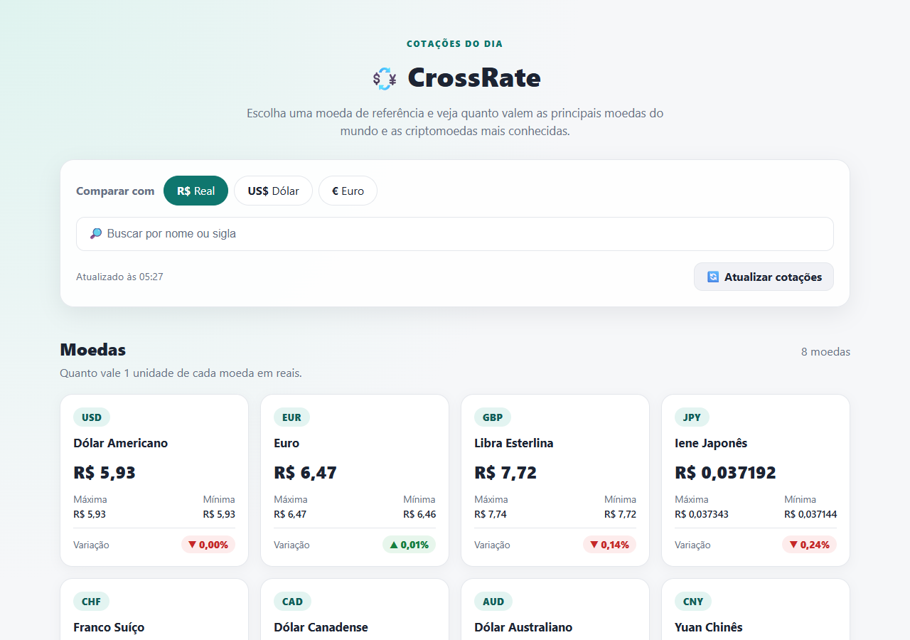
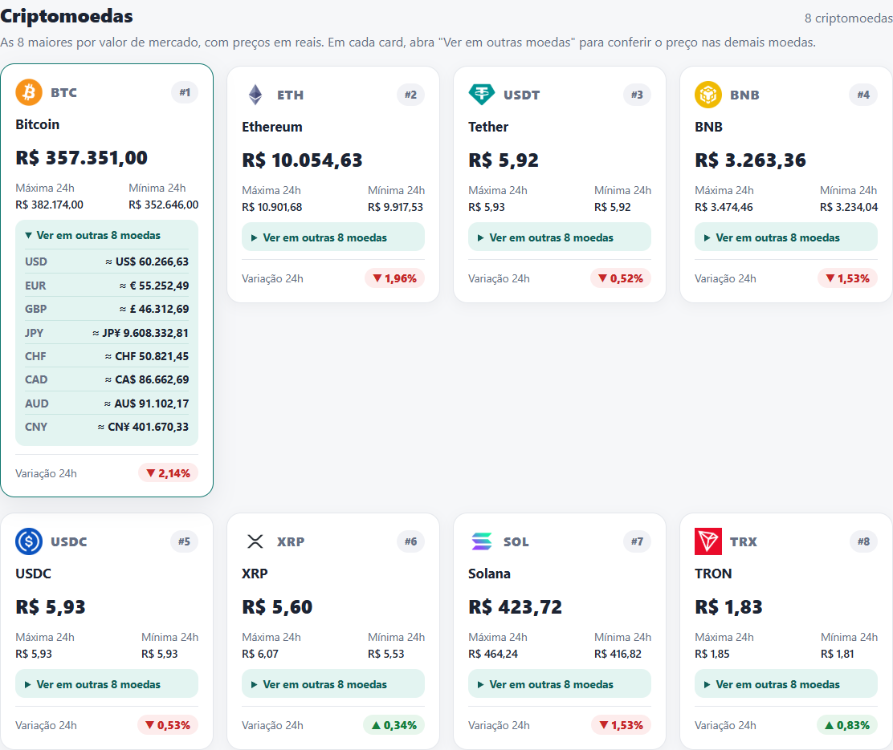
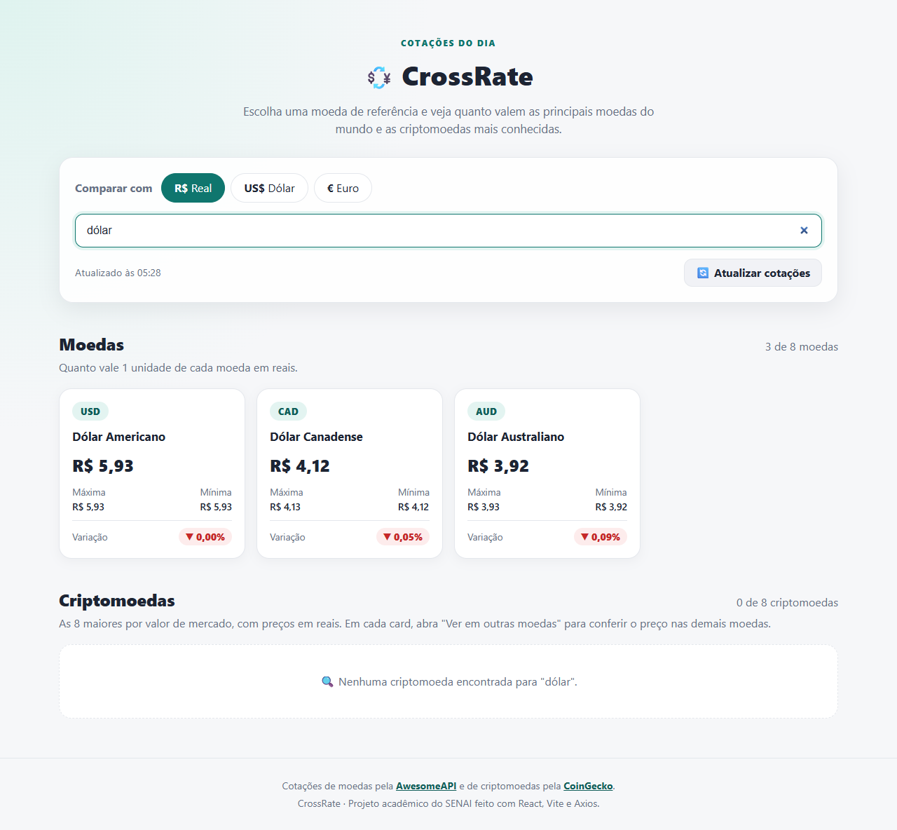
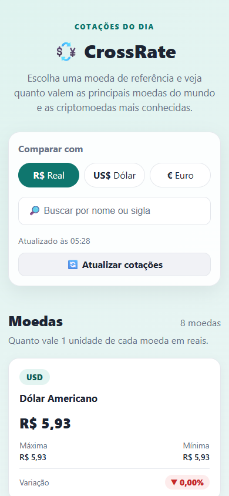

# CrossRate

Aplicação web desenvolvida em React, Vite e Axios para acompanhamento de cotações de moedas fiduciárias e criptomoedas, permitindo alternar dinamicamente a moeda de referência da comparação (*cross-rate*) entre **BRL**, **USD** e **EUR**.

🌐 **Acesse online:** [crossrate-delta.vercel.app](https://crossrate-delta.vercel.app)



---

## 📑 Sumário

1. [Telas](#-telas)
2. [Objetivo acadêmico](#-objetivo-acadêmico)
3. [Funcionalidades](#-funcionalidades)
4. [Como usar](#-como-usar)
5. [Requisitos da atividade](#-requisitos-da-atividade)
6. [Tecnologias](#-tecnologias)
7. [APIs utilizadas e documentação](#-apis-utilizadas-e-documentação)
8. [Limitações das APIs](#-limitações-das-apis)
9. [Como o preço das criptomoedas nas outras moedas é calculado](#-como-o-preço-das-criptomoedas-nas-outras-moedas-é-calculado)
10. [Componentes](#-componentes)
11. [Hook useRates](#-hook-userates)
12. [Funções de formatação](#-funções-de-formatação)
13. [Estados da tela](#-estados-da-tela)
14. [Responsividade e acessibilidade](#-responsividade-e-acessibilidade)
15. [Estrutura de pastas](#-estrutura-de-pastas)
16. [Fluxo dos dados](#-fluxo-dos-dados)
17. [Instalação e execução](#-instalação-e-execução)
18. [Deploy na Vercel](#-deploy-na-vercel)
19. [Autor](#-autor)

---

## 📸 Telas

**Criptomoedas, com o preço do Bitcoin nas outras moedas aberto:**



**Busca por "dólar":** as moedas são filtradas e a seção de criptomoedas avisa que nada foi encontrado.



**Versão para celular:**



---

## 🎯 Objetivo acadêmico

Projeto desenvolvido como atividade do curso SENAI para praticar o consumo de APIs REST públicas em React. Os conceitos trabalhados são:

* Criação de projeto com **Vite + React (JavaScript)**;
* Requisições HTTP `GET` com **Axios** e instâncias configuradas com `axios.create()`;
* Uso de **`useEffect`** para disparar requisições e de **`useState`** para guardar dados, carregamento e erros;
* Hook personalizado (`useRates`) para separar a lógica de dados da interface;
* Renderização de listas com **`.map()`** e `key` únicas;
* Componentização com dados passados por **props**;
* Filtro local com **`.filter()`** (busca).

---

## ✅ Funcionalidades

* **Seleção da moeda de referência:** botões para BRL (padrão), USD ou EUR. Ao trocar, as duas listagens são recarregadas já convertidas para a moeda escolhida.
* **Moedas fiduciárias (AwesomeAPI):** 8 moedas internacionais (USD, EUR, BRL, GBP, JPY, CHF, CAD, AUD e CNY, sem a moeda de referência) com nome, sigla, cotação atual, máxima, mínima e variação percentual.
* **Criptomoedas (CoinGecko):** as 8 maiores por capitalização de mercado, com imagem, nome, sigla, posição no ranking, cotação atual, máxima e mínima de 24h e variação percentual de 24h.
* **Criptomoedas em cada moeda (cross rate):** cada card de criptomoeda tem um "Ver em outras 8 moedas" que mostra o preço dela em cada uma das outras moedas da listagem. O valor é calculado combinando as duas APIs, sem nenhuma requisição extra (veja [como o cálculo é feito](#-como-o-preço-das-criptomoedas-nas-outras-moedas-é-calculado)).
* **Busca (bônus):** campo que filtra as duas listagens em tempo real pelo nome ou pela sigla, usando `.filter()` sobre os dados já armazenados no estado (nenhuma requisição nova a cada tecla). Exibe mensagem quando nada é encontrado.
* **Contador de resultados** ao lado do título de cada seção (ex.: `8 moedas` ou `2 de 8 moedas` durante a busca).
* **Atualizar cotações:** botão que busca os dados de novo e mostra o horário da última atualização.
* **Feedback ao usuário:**
  * mensagem de carregamento em cada listagem;
  * mensagem amigável de erro;
  * as duas APIs são tratadas de forma **independente**: se uma falhar, a outra listagem continua funcionando;
  * valores ausentes são exibidos como `—`;
  * variação positiva em verde (▲) e negativa em vermelho (▼); a seta ajuda quem tem dificuldade para diferenciar cores.
* **Layout responsivo** com cards em grid (computador e celular).

---

## 🧭 Como usar

1. Abra o site (ou rode o projeto localmente, veja [Instalação e execução](#-instalação-e-execução)).
2. Em **Comparar com**, escolha a moeda de referência: **R$ Real**, **US$ Dólar** ou **€ Euro**. Todos os preços passam a ser mostrados nessa moeda.
3. Na seção **Moedas**, cada card mostra quanto vale 1 unidade daquela moeda na moeda escolhida. Ex.: com Real selecionado, o card `USD` mostra quanto vale 1 dólar em reais.
4. Na seção **Criptomoedas**, clique em **Ver em outras 8 moedas** em qualquer card para ver o preço daquela cripto em dólar, euro, libra, iene etc. Clique de novo para fechar.
5. Digite no campo **Buscar por nome ou sigla** para filtrar as duas seções (ex.: `dólar`, `eur`, `btc`, `solana`). Apague o texto para ver tudo de novo.
6. Clique em **Atualizar cotações** para buscar os valores mais recentes. O horário da última atualização aparece ao lado do botão.

---

## 📋 Requisitos da atividade

| Requisito | Onde foi atendido |
| :--- | :--- |
| React + Vite + JavaScript (sem TypeScript) | Projeto criado com Vite; todos os arquivos são `.jsx`/`.js` |
| Todas as requisições com Axios | `src/services/api.js` e `src/hooks/useRates.js` |
| Duas instâncias com `axios.create()` | `awesomeApi` e `coinGeckoApi` em `src/services/api.js` |
| CSS puro separado dos componentes | `index.css`, `App.css` e um `styles.css` em cada componente |
| Componentes `Header`, `Footer`, `CurrencyCard` e `CryptoCard` | `src/components/` (cada um com `index.jsx` + `styles.css`) |
| Hook `useRates` com `useEffect` e `useState` | `src/hooks/useRates.js` |
| Seletor de moeda de referência BRL (padrão), USD e EUR | `App.jsx` (`BASE_CURRENCIES` e `useState("BRL")`) |
| Cards de moedas fiduciárias (AwesomeAPI `/last` e `/available`) | `useRates.js` + `CurrencyCard` |
| 8 criptomoedas (CoinGecko `/coins/markets`, `per_page=8`) | `useRates.js` + `CryptoCard` |
| Busca com `.filter()` sem novas requisições (bônus) | `App.jsx` (`filteredCurrencies` e `filteredCryptos`) |
| Carregamento, erro e valores ausentes | Ver [Estados da tela](#-estados-da-tela) |
| APIs tratadas de forma independente | Estados separados para cada API em `useRates.js` |
| Variação em verde/vermelho | `getChangeClass` em `src/utils/format.js` |
| Rodapé com créditos das APIs | `src/components/Footer` |
| Repositório público, sem `node_modules`, `dist` ou credenciais | `.gitignore`; nenhuma chave de API é necessária |

---

## 💻 Tecnologias

| Tecnologia | Versão | Uso |
| :--- | :--- | :--- |
| [React](https://react.dev/) | 19 | Interface e hooks (`useState`, `useEffect`) |
| [Vite](https://vite.dev/) | 8 | Criação do projeto, servidor de desenvolvimento e build |
| [Axios](https://axios-http.com/) | 1.x | Requisições HTTP |
| CSS puro | — | Estilização (um `styles.css` por componente) |
| [ESLint](https://eslint.org/) | 10 | Verificação de código (`npm run lint`) |
| [Vercel](https://vercel.com/) | — | Hospedagem da versão online |

Não foram usados Next.js, TypeScript, Tailwind, Styled Components, Redux, React Router, backend próprio, autenticação nem bibliotecas de gráficos.

---

## 🌐 APIs utilizadas e documentação

O projeto consome duas APIs REST públicas e gratuitas, **sem chave de acesso**, através de instâncias separadas configuradas com `axios.create()` em `src/services/api.js`:

```js
import axios from "axios";

// Cotações de moedas fiduciárias
export const awesomeApi = axios.create({
  baseURL: "https://economia.awesomeapi.com.br/json",
  timeout: 10000,
});

// Cotações de criptomoedas
export const coinGeckoApi = axios.create({
  baseURL: "https://api.coingecko.com/api/v3",
  timeout: 10000,
});
```

O `timeout` de 10 segundos faz a requisição falhar (e mostrar a mensagem de erro) em vez de ficar carregando para sempre caso a API não responda.

### 1. AwesomeAPI: cotações de moedas fiduciárias

Utilizada como fonte para o câmbio comercial entre moedas internacionais.

* **Base URL:** `https://economia.awesomeapi.com.br/json`
* **Endpoints consumidos:**
  * `GET /available`: lista os pares suportados. É consultado antes das cotações para montar apenas pares válidos.
  * `GET /last/{pares}`: última cotação dos pares (ex.: `/last/USD-BRL,EUR-BRL,GBP-BRL`).
* **Documentação oficial:** [AwesomeAPI - API de Moedas](https://docs.awesomeapi.com.br/api-de-moedas)
* **Pares disponíveis:** [Lista de combinações suportadas](https://economia.awesomeapi.com.br/json/available)

Os pares são montados no formato `{MOEDA}-{REFERÊNCIA}`. Por exemplo, com BRL selecionado, `USD-BRL` retorna quanto vale 1 dólar em reais. A resposta é um objeto com chaves sem o hífen (`USDBRL`, `EURBRL`...), que o hook transforma em array para usar `.map()`.

**Exemplo de resposta** de `GET /last/USD-BRL`:

```json
{
  "USDBRL": {
    "code": "USD",
    "codein": "BRL",
    "name": "Dólar Americano/Real Brasileiro",
    "high": "5.9295",
    "low": "5.9295",
    "varBid": "0",
    "pctChange": "-0.000002",
    "bid": "5.9295",
    "ask": "5.9296",
    "timestamp": "1795506370",
    "create_date": "2026-11-24 04:46:10"
  }
}
```

**Principais campos utilizados na resposta:**

| Campo | Tipo | Descrição |
| :--- | :--- | :--- |
| `code` | `string` | Sigla da moeda de origem (ex.: `EUR`, `GBP`) |
| `codein` | `string` | Sigla da moeda de referência (ex.: `BRL`); usada na formatação do preço e na `key` |
| `name` | `string` | Nome do par (ex.: `Dólar Americano/Real Brasileiro`); é exibida só a parte antes da `/` |
| `bid` | `string` | Valor de compra (cotação atual de referência) |
| `high` | `string` | Cotação máxima registrada |
| `low` | `string` | Cotação mínima registrada |
| `pctChange` | `string` | Variação percentual |

Repare que os números chegam como **texto** (`"5.9295"`). Por isso o código usa `Number()` antes de formatar ou fazer contas.

---

### 2. CoinGecko API: mercado de criptomoedas

Utilizada para listar os principais criptoativos por capitalização de mercado, convertidos diretamente para a moeda de referência selecionada.

* **Base URL:** `https://api.coingecko.com/api/v3`
* **Endpoint consumido:** `GET /coins/markets`
* **Parâmetros enviados:**

| Parâmetro | Valor | Descrição |
| :--- | :--- | :--- |
| `vs_currency` | `brl`, `usd` ou `eur` | Moeda de referência selecionada |
| `order` | `market_cap_desc` | Ordena pela capitalização de mercado |
| `per_page` | `8` | Quantidade de criptomoedas |
| `page` | `1` | Primeira página |

No código, os parâmetros são passados pelo objeto `params` do Axios, que monta a URL sozinho:

```js
coinGeckoApi.get("/coins/markets", {
  params: { vs_currency: "brl", order: "market_cap_desc", per_page: 8, page: 1 },
});
// GET https://api.coingecko.com/api/v3/coins/markets?vs_currency=brl&order=market_cap_desc&per_page=8&page=1
```

* **Documentação oficial (endpoint):** [CoinGecko - Coins Markets](https://docs.coingecko.com/reference/coins-markets)
* **Documentação geral e limites:** [CoinGecko API Introduction](https://docs.coingecko.com/reference/introduction)
* **Moedas de referência suportadas:** [Supported VS Currencies](https://api.coingecko.com/api/v3/simple/supported_vs_currencies)

**Exemplo de resposta** (trecho de um item da lista, só com os campos usados; valores ilustrativos):

```json
[
  {
    "id": "bitcoin",
    "symbol": "btc",
    "name": "Bitcoin",
    "image": "https://coin-images.coingecko.com/coins/images/1/large/bitcoin.png",
    "current_price": 357351,
    "market_cap_rank": 1,
    "high_24h": 382174,
    "low_24h": 352646,
    "price_change_percentage_24h": -2.14
  }
]
```

**Principais campos utilizados na resposta:**

| Campo | Tipo | Descrição |
| :--- | :--- | :--- |
| `id` | `string` | Identificador único do criptoativo (usado como `key` na listagem) |
| `symbol` | `string` | Sigla da criptomoeda (ex.: `btc`, `eth`) |
| `name` | `string` | Nome completo do ativo (ex.: `Bitcoin`) |
| `image` | `string` | URL do logotipo oficial do ativo |
| `current_price` | `number` | Preço atual na moeda definida em `vs_currency` |
| `market_cap_rank` | `number` | Posição no ranking global por capitalização |
| `high_24h` | `number` | Preço máximo nas últimas 24 horas |
| `low_24h` | `number` | Preço mínimo nas últimas 24 horas |
| `price_change_percentage_24h` | `number` | Variação percentual nas últimas 24 horas |

---

## 🚧 Limitações das APIs

* **Limite de requisições da CoinGecko:** a API pública (sem chave) aceita poucas requisições por minuto. Nos testes, o bloqueio apareceu depois de umas 4 chamadas feitas em poucos segundos. Quando isso acontece, a API responde `429` **sem o cabeçalho CORS**, então o navegador só enxerga um erro de rede. A aplicação mostra uma mensagem pedindo para aguardar e a listagem de moedas continua funcionando normalmente.
  * Para diminuir o problema, o hook guarda a resposta da CoinGecko de cada moeda por **1 minuto**. Voltar para uma moeda já consultada (ex.: BRL → USD → BRL) não faz uma requisição nova. O botão **Atualizar cotações** ignora esse cache.
* **Modo de desenvolvimento:** o `<StrictMode>` do React executa os efeitos duas vezes ao abrir a página em `npm run dev`, dobrando as primeiras requisições. Isso não acontece no build de produção.
* **Pares inválidos na AwesomeAPI:** se um único par da URL não existir, a API retorna `404` para a requisição inteira. Por isso o hook consulta `/available` e envia apenas pares suportados.
* **Atualização dos dados:** as cotações não são em tempo real a cada segundo. As APIs atualizam os valores periodicamente, e a aplicação busca novos dados ao abrir a página, ao trocar a moeda de referência e ao clicar em **Atualizar cotações**.
* **Preço nas outras moedas é aproximado:** a conversão usa o câmbio da AwesomeAPI, e não o da CoinGecko, por isso aparece com `≈`. Nos testes, comparamos as 64 conversões (8 criptos × 8 moedas) com o preço que a própria CoinGecko informa em cada moeda: a maior diferença foi de 0,7%, a maior parte por arredondamento.
* **A conversão depende das duas APIs:** se a AwesomeAPI falhar, os cards de criptomoeda continuam aparecendo, só sem o "Ver em outras moedas".

---

## 🔁 Como o preço das criptomoedas nas outras moedas é calculado

A CoinGecko informa o preço de cada criptomoeda na moeda de referência, e a AwesomeAPI informa quanto vale cada moeda nessa mesma referência. Dividindo um pelo outro, chegamos ao preço da cripto em cada moeda. É o que se chama de **cross rate** (taxa cruzada), que dá nome ao projeto:

```text
1 BTC  = R$ 357.195   (CoinGecko, vs_currency=brl)
1 USD  = R$ 5,93      (AwesomeAPI, par USD-BRL)

1 BTC em dólar = 357.195 ÷ 5,93 ≈ US$ 60.235
```

No código (`App.jsx`), cada cripto recebe a lista de conversões por props:

```js
function getConversions(crypto) {
  if (!crypto.current_price) return [];

  return currencies
    .filter((currency) => Number(currency.bid))
    .map((currency) => ({
      code: currency.code,
      name: getCurrencyName(currency),
      price: crypto.current_price / Number(currency.bid),
    }));
}
```

* O `.filter()` descarta moedas sem cotação válida, evitando divisão por zero.
* A função usa a lista **completa** de moedas (e não a filtrada pela busca), para que as conversões não sumam enquanto o usuário pesquisa.

O `CryptoCard` mostra essa lista dentro de um `<details>` do HTML, que abre e fecha sem precisar de estado. Assim não é preciso fazer nenhuma requisição a mais, o que é importante por causa do limite da CoinGecko.

---

## 🧩 Componentes

Todos os componentes ficam em `src/components/`, cada um em sua própria pasta com `index.jsx` e `styles.css`.

| Componente | Props | O que faz |
| :--- | :--- | :--- |
| `Header` | — | Mostra o nome do projeto e uma descrição curta do que a aplicação faz. |
| `Footer` | — | Mostra os créditos e links da AwesomeAPI e da CoinGecko e identifica o projeto. |
| `CurrencyCard` | `currency` | Card de uma moeda fiduciária: sigla, nome, cotação, máxima, mínima e variação. Usa `currency.codein` para formatar os valores na moeda de referência. |
| `CryptoCard` | `crypto`, `currency`, `conversions` | Card de uma criptomoeda: logo, sigla, ranking, nome, preço, máxima e mínima de 24h, variação de 24h e a lista "Ver em outras moedas". |

Detalhes das props:

* **`currency`** (`CurrencyCard`): um item da resposta da AwesomeAPI (`code`, `codein`, `name`, `bid`, `high`, `low`, `pctChange`).
* **`crypto`** (`CryptoCard`): um item da resposta da CoinGecko. Os nomes dos campos são renomeados com desestruturação para ficarem mais legíveis (ex.: `current_price: price`).
* **`currency`** (`CryptoCard`): a sigla da moeda de referência (`"BRL"`, `"USD"` ou `"EUR"`), usada para formatar os preços.
* **`conversions`** (`CryptoCard`): lista `[{ code, name, price }]` com o preço da cripto em cada moeda. Tem `[]` como valor padrão; se estiver vazia, o "Ver em outras moedas" não aparece.

Os dois cards retornam `null` se não receberem dados, e usam `??` e as funções de formatação para mostrar `—` quando algum campo vem vazio.

---

## 🪝 Hook useRates

`src/hooks/useRates.js` concentra toda a busca de dados, deixando o `App.jsx` só com a interface.

```js
const { currencies, cryptos, isLoadingCurrencies, currencyError, refresh, ... } = useRates(baseCurrency);
```

**Recebe:** `baseCurrency`, a sigla da moeda de referência (`"BRL"`, `"USD"` ou `"EUR"`).

**Retorna:**

| Valor | Tipo | Descrição |
| :--- | :--- | :--- |
| `currencies` | `array` | Cotações das moedas fiduciárias (AwesomeAPI) |
| `isLoadingCurrencies` | `boolean` | `true` enquanto as moedas estão sendo buscadas |
| `currencyError` | `string` ou `null` | Mensagem de erro das moedas, se houver |
| `cryptos` | `array` | Lista das 8 criptomoedas (CoinGecko) |
| `isLoadingCryptos` | `boolean` | `true` enquanto as criptomoedas estão sendo buscadas |
| `cryptoError` | `string` ou `null` | Mensagem de erro das criptomoedas, se houver |
| `lastUpdate` | `Date` ou `null` | Horário da última resposta recebida |
| `refresh` | `function` | Busca tudo de novo (usada pelo botão **Atualizar cotações**) |

**Como funciona por dentro:**

* São **dois `useEffect`**, um para cada API, com as dependências `[baseCurrency, refreshCount]`. Trocar a moeda ou clicar em atualizar faz os dois rodarem de novo.
* Cada efeito segue o mesmo padrão: liga o carregamento, limpa o erro anterior, faz a requisição dentro de `try/catch` e, no `finally`, desliga o carregamento.
* A lista de moedas é definida na constante `FIAT_CURRENCIES` (9 moedas). A moeda de referência é retirada da lista, então sempre aparecem 8 cards.
* **Cache da CoinGecko:** a resposta de cada `vs_currency` fica guardada no objeto `cryptoCache` por 1 minuto (`CACHE_TIME`). Se a mesma moeda for pedida de novo nesse intervalo, a resposta guardada é usada sem nova requisição.
* **`refresh()`** apaga o cache da moeda atual e soma 1 ao `refreshCount`, forçando as duas buscas.
* **Variável `ignore`:** a função de limpeza do `useEffect` marca `ignore = true`. Se o usuário trocar de moeda antes da resposta anterior chegar, essa resposta antiga é descartada e não sobrescreve os dados novos.

---

## 🧰 Funções de formatação

`src/utils/format.js` reúne as funções usadas pelos cards e pela página:

| Função | Exemplo | Descrição |
| :--- | :--- | :--- |
| `formatPrice(value, currency)` | `formatPrice(5.93, "BRL")` → `R$ 5,93` | Formata no padrão brasileiro com o símbolo da moeda. Valores menores que 1 ganham até 6 casas decimais (ex.: `R$ 0,037192` para o iene). Valor inválido vira `—`. |
| `formatChange(value)` | `formatChange(-0.24)` → `▼ 0,24%` | Formata a variação com seta para cima ou para baixo. |
| `getChangeClass(value)` | `getChangeClass(1.2)` → `"change-positive"` | Escolhe a classe CSS da variação: verde, vermelha ou cinza (zero ou sem valor). |
| `getCurrencyName(currency)` | `"Dólar Americano/Real Brasileiro"` → `"Dólar Americano"` | Pega só o nome da moeda de origem. |
| `formatTime(date)` | → `14:05` | Mostra a hora da última atualização. |

A formatação usa `toLocaleString("pt-BR", { style: "currency", currency })`, nativo do JavaScript, sem bibliotecas extras.

---

## 💬 Estados da tela

Cada seção (Moedas e Criptomoedas) mostra uma destas situações, de forma independente:

| Situação | O que aparece |
| :--- | :--- |
| Buscando dados | ⏳ "Buscando cotações das moedas..." / "Buscando cotações das criptomoedas..." |
| Erro na AwesomeAPI | ⚠️ "Não conseguimos buscar as cotações das moedas agora. Tente atualizar daqui a pouco." |
| Erro na CoinGecko | ⚠️ Mensagem explicando que a CoinGecko gratuita aceita poucas consultas por minuto e pedindo para aguardar e atualizar |
| Busca sem resultado | 🔍 "Nenhuma moeda encontrada para "..."" / "Nenhuma criptomoeda encontrada para "..."" |
| Campo sem valor na API | `—` no lugar do número |
| Tudo certo | Os cards da seção |

Ao lado do botão **Atualizar cotações** aparece "Buscando cotações...", "Atualizado às HH:MM" ou "Ainda não foi possível atualizar". O botão fica desativado enquanto as cotações carregam, para evitar cliques repetidos.

---

## 📱 Responsividade e acessibilidade

O grid de cards se adapta à largura da tela:

| Largura da tela | Cards por linha |
| :--- | :--- |
| Acima de 1000px | 4 |
| Até 1000px | 3 |
| Até 760px | 2 |
| Até 520px (celular) | 1, com os botões de moeda e o de atualizar ocupando a largura toda |

O grid usa `align-items: start`, então abrir o "Ver em outras moedas" em um card não estica os outros cards da mesma linha.

Cuidados de acessibilidade:

* os botões de moeda usam `aria-pressed` para indicar qual está selecionado;
* o campo de busca tem `aria-label`;
* as imagens das criptomoedas têm texto alternativo (`alt`);
* a variação usa seta (▲/▼) além da cor;
* botões e campo de busca têm destaque visível ao navegar pelo teclado.

---

## 📁 Estrutura de pastas

```text
CrossRate/
├── docs/
│   └── screenshots/         # Imagens usadas neste README
├── public/
│   └── favicon.svg          # Ícone da aba do navegador
├── src/
│   ├── components/
│   │   ├── Header/          # Título e descrição da aplicação
│   │   │   ├── index.jsx
│   │   │   └── styles.css
│   │   ├── Footer/          # Créditos das APIs e identificação do projeto
│   │   │   ├── index.jsx
│   │   │   └── styles.css
│   │   ├── CurrencyCard/    # Card de moeda fiduciária (recebe dados por props)
│   │   │   ├── index.jsx
│   │   │   └── styles.css
│   │   └── CryptoCard/      # Card de criptomoeda (recebe dados por props)
│   │       ├── index.jsx
│   │       └── styles.css
│   ├── hooks/
│   │   └── useRates.js      # Requisições com useEffect + estados com useState
│   ├── services/
│   │   └── api.js           # Duas instâncias do Axios (AwesomeAPI e CoinGecko)
│   ├── utils/
│   │   └── format.js        # Formatação de preços, variações e horário
│   ├── App.jsx              # Página: seleção de moeda, busca, conversões e listagens
│   ├── App.css              # Estilos da página
│   ├── index.css            # Paleta de cores e estilos globais dos cards
│   └── main.jsx             # Ponto de entrada do React
├── index.html
├── package.json
└── vite.config.js
```

---

## 🔄 Fluxo dos dados

```text
App (useState: baseCurrency, searchTerm)
 │
 ├─ useRates(baseCurrency) ── useEffect [baseCurrency, refreshCount] ──► awesomeApi.get("/available") + ("/last/...")
 │                         └─ useEffect [baseCurrency, refreshCount] ──► coinGeckoApi.get("/coins/markets", { params })
 │        │
 │        └─ respostas salvas com useState (dados, carregando, erro) para cada API
 │
 ├─ .filter() pelo searchTerm (sem novas requisições)
 ├─ preço da cripto ÷ cotação da moeda = cripto em cada moeda
 │
 └─ .map() ──► <CurrencyCard currency={...} />   <CryptoCard crypto={...} currency={...} conversions={...} />
```

1. O usuário escolhe a moeda de referência; o valor fica em um `useState` no `App`.
2. O hook `useRates` recebe essa moeda. Seus dois `useEffect` têm `baseCurrency` e `refreshCount` como dependências, então são executados de novo quando a moeda muda ou quando o usuário clica em **Atualizar cotações** (que soma 1 ao `refreshCount`).
3. Cada efeito usa sua instância do Axios (`src/services/api.js`), liga o carregamento, faz a requisição e guarda o resultado (ou a mensagem de erro) em `useState`. Cada API tem seus próprios estados, por isso uma falha não afeta a outra.
4. Uma variável `ignore` na função de limpeza do `useEffect` descarta respostas antigas caso o usuário troque de moeda antes da requisição anterior terminar.
5. O `App` aplica a busca com `.filter()` e renderiza os cards com `.map()`, usando `key` estáveis (`code-codein` para moedas e `id` para criptomoedas). Os cards recebem os dados por props.

---

## 📦 Instalação e execução

Pré-requisitos:

* [Node.js](https://nodejs.org/) **20.19 ou superior** (ou 22.12+), exigido pelo Vite 8;
* npm (já vem com o Node.js);
* [Git](https://git-scm.com/) para clonar o repositório.

```bash
# Clonar o repositório
git clone https://github.com/RHU4N/CrossRate.git
cd CrossRate

# Instalar as dependências
npm install

# Rodar em modo de desenvolvimento (http://localhost:5173)
npm run dev
```

Outros comandos:

| Comando | O que faz |
| :--- | :--- |
| `npm run dev` | Sobe o servidor de desenvolvimento com atualização automática |
| `npm run lint` | Verifica o código com ESLint |
| `npm run build` | Gera a versão de produção na pasta `dist/` |
| `npm run preview` | Serve localmente o build de produção |

Não é necessário configurar variáveis de ambiente nem chaves de API.

---

## 🚀 Deploy na Vercel

A versão online fica em **[crossrate-delta.vercel.app](https://crossrate-delta.vercel.app)**.

O projeto da Vercel está ligado a este repositório do GitHub. A cada `push` na branch `main`, a Vercel roda `npm run build` e publica a pasta `dist/` automaticamente. Como o projeto é só front-end e as APIs são públicas, não há nenhuma configuração extra.

Para publicar uma cópia em outra conta: em [vercel.com/new](https://vercel.com/new), importe o repositório; a Vercel reconhece o Vite sozinha (comando de build `npm run build`, pasta de saída `dist`).

---

## 👤 Autor

Desenvolvido por [RHU4N](https://github.com/RHU4N) como projeto acadêmico do SENAI.

Dados de cotação fornecidos pela [AwesomeAPI](https://docs.awesomeapi.com.br/) e pela [CoinGecko](https://www.coingecko.com/).
